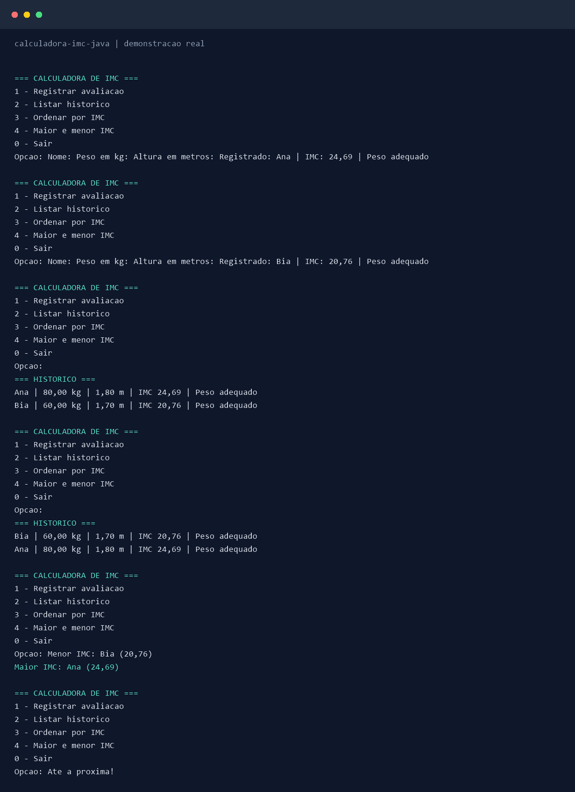

# Calculadora de IMC com Histórico

Projeto **02/49** da trilha de portfólio. Aplicação Java de terminal para registrar avaliações de IMC, consultar o histórico, ordenar registros e visualizar o maior e o menor IMC.

## Tecnologias

- Java 25
- Maven
- JUnit 6
- Java Collections e `Comparator`

## Funcionalidades

- Cadastro de avaliações com nome, peso em quilogramas e altura em metros
- Validação de entradas numéricas, nome obrigatório e rejeição de valores não finitos
- Cálculo de IMC (`peso / altura²`) e classificação conforme faixas convencionais para adultos
- Histórico em memória com ordem de inclusão
- Listagem ordenada por IMC sem alterar a ordem original
- Consulta ao maior e ao menor IMC registrado
- Menu interativo e encerramento pelo usuário

**Limitação:** o histórico é mantido em memória e desaparece ao encerrar. Este programa é educativo; o IMC não constitui diagnóstico individual e as faixas apresentadas destinam-se a adultos.

## Como executar

Pré-requisitos: **JDK 25** e **Apache Maven**.

```powershell
mvn clean verify
java -jar target/calculadora-imc-java-1.0.0.jar
```

## Demonstração



Imagem gerada a partir da saída real do programa, registrada em
[exemplo-execucao.txt](docs/exemplo-execucao.txt).


No menu, escolha `1` para registrar, `2` para listar, `3` para ordenar, `4` para consultar extremos e `0` para sair.

O arquivo `docs/exemplo-execucao.txt` será gerado automaticamente na preparação local a partir de uma execução real. A imagem acima apresenta essa execução em formato visual.

## Estrutura

- `Main`: menu e interação com o terminal
- `CalculadoraImc`: cálculo e classificação do IMC
- `ClassificacaoImc`: enum com faixas de classificação
- `Avaliacao`: dados imutáveis de uma avaliação
- `HistoricoAvaliacoes`: coleção e consultas do histórico
- `src/test`: testes automatizados

## Aprendizados

Classes, construtores, métodos, encapsulamento, `enum`, `ArrayList`, `List`, `Comparator`, `Optional`, validação de argumentos, tratamento de exceções e testes unitários.
